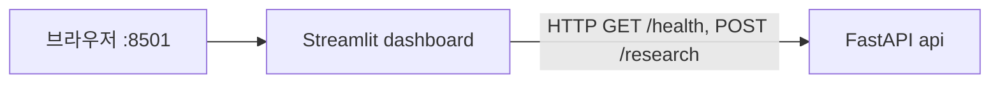

# 개발 상태와 CI/CD

## 현재 범위



- Python 3.12를 사용한다. 학교의 필수 기준은 Python 3.10 이상이며,
  권장 구현 순서에 등장하는 3.10은 고정 버전 요구가 아니다.
- `/health`와 `POST /research`를 구현했다. Pydantic 스키마와 Swagger UI를 제공한다.
  `status: ok`는 HTTP 서버 동작을 뜻하고 투자 추론 준비 상태를 의미하지 않는다.
  모델 로더가 없으므로 `model_loaded`는 항상 `false`다.
- Streamlit은 HTTP 응답만 표시한다. backend 코드나 모델 파일을 읽지 않는다.
- Dockerfile의 `api`, `dashboard` 빌드 대상을 분리하고 각 서비스의 의존성만 설치한다.
  직접 사용하는 의존성 버전은 각 `requirements.txt`에 고정했다.
  전이 의존성 전체를 잠그는 lock 파일은 아직 없다.
- 기본 Compose 서비스는 두 개뿐이다. 수집·학습·전체 백테스트 실행 코드는 없으며,
  서버 시작·API 요청 시 자동 실행되지 않는다. 향후 별도 명령/작업으로 구현한다.
- `.dockerignore`는 현재 실행에 필요한 파일만 허용한다. 새 런타임 모듈을 추가할 때
  Dockerfile의 `COPY`와 `.dockerignore`를 함께 갱신해야 한다.
  기본 health·Swagger에는 데이터·모델·키가 필요 없다. 실제 리서치에는 별도 준비가 필요하다.

## 학교 요구사항 중 미구현

- API: `POST /optimize`, `POST /explain`, `GET /backtest`.
  등록하지 않았으므로 404를 반환한다.
- 대시보드 6개 페이지: 포트폴리오 현황, 강화학습 성과, SHAP 해석,
  에이전트 리서치, ANOVA 결과, 리스크 모니터링.
- 10개 이상 자산의 5년 이상 데이터 수집, 전처리, 기술적 지표.
- Gymnasium 환경, 거래비용, 보상 함수 3종, PPO 학습, Safe-Guard.
- Walk-Forward 백테스트, 12개 성과 지표, MVO·벤치마크 비교.
- SHAP, ANOVA·사후 검정, 리서치 결과의 투자 모델·리스크 모니터링 연동.
- 모델 로딩과 추론 시간·투자 성과 기준 검증.
- 보상 함수 설계 근거, 성능·ANOVA 요약, 에러 분석 및 20페이지 이상 실험 리포트.

현재 테스트는 실행 기반을 검증한다. 금융·모델 기능의 테스트는 해당 구현 이후에
추가해야 한다. 학교 최종 제출물 전체가 완성된 상태가 아니다.
권장 다음 순서는 데이터 수집·전처리 → 거래 환경·학습 → 백테스트·해석·리서치
→ API·대시보드 통합이다. MLflow, 주기적 수집·재학습, 이상거래 탐지,
멀티모달, 공정성 분석은 학교의 선택 과제다.

## PR CI

`.github/workflows/ci.yml`은 PR 생성, 추가 push(`synchronize`), 재오픈,
리뷰 준비 전환 시 실행된다. 저장소 읽기 권한만 사용하며 secrets가 필요 없다.

| 상태 검사 이름 | 실행 내용 |
| --- | --- |
| `quality` | Python 3.12 의존성 설치·호환성 확인, Black, flake8, pytest |
| `docker-smoke` | 두 이미지 빌드, Compose healthcheck 대기, 공개 HTTP 포트, dashboard 내부에서 실제 API 호출·화면 렌더링·새로고침 |

```bash
python -m pip install -r requirements-dev.txt
python -m pip check
python -m black --check backend frontend tests scripts
python -m flake8 backend frontend tests scripts
python -m pytest -q
```

단위 테스트는 FastAPI TestClient와 모의 HTTP 응답을 사용한다.
`scripts/smoke.py`는 Compose dashboard 컨테이너 안에서 실제 API를 호출하고
Streamlit AppTest로 페이지를 실행한다. 브라우저 자동화 검사는 아니다.
CI에서 데이터 수집, 재학습, 전체 백테스트, 외부 LLM 호출은 하지 않는다.
패키지·베이스 이미지 다운로드에는 인터넷 연결이 필요하다.

GitHub에서 첫 PR의 CI 실행 후 기본 브랜치의 Settings → Rules → Rulesets
(또는 Branches → Branch protection)에 PR 필수 규칙과 필수 상태 검사
`quality`, `docker-smoke`를 지정한다. 상태 검사 목록에서는 `CI` 워크플로의
해당 이름을 선택한다. 워크플로 파일만 추가해도 병합 차단 규칙이 자동 설정되지는 않는다.
기존 Issue 브랜치 워크플로와 Issue/PR 템플릿은 유지한다.

## 로컬 검증 결과 (2026-10-02)

- `python -m pip check`, Black 검사, flake8 통과.
- `python -m pytest -q`: 18개 케이스 통과(테스트 함수 10개, 매개변수 사례 포함).
  Starlette TestClient의 httpx 사용에 대한 폐기 예정 경고 1건이 있다.
  실제 금융·모델 기능 검증을 대신하는 테스트가 아니다.
- `docker compose config --quiet`, `docker compose build` 통과.
- `docker compose up --build -d --wait --wait-timeout 120`: 두 서비스 healthy.
- 호스트의 `/health`: HTTP 200, `{"status":"ok","model_loaded":false}`.
  Streamlit `/_stcore/health`: HTTP 200, `ok`.
- dashboard 컨테이너 안에서 `scripts/smoke.py` 실행 통과:
  실제 `api` 서비스 HTTP 호출, 모델 미로드 표시, 화면 새로고침 확인.
  PowerShell에서는 UTF-8로 스크립트를 표준입력으로 전달했다.
- 두 컨테이너의 `python -m pip check` 통과. `/app`에는 각 서비스의 소스와
  requirements 파일만 있으며 `.env`, 데이터, 모델 파일이 없음을 확인했다.
- Git 제외 규칙 확인: `.env`, `.env.local`, 실제 데이터 경로, 모델 파일,
  Streamlit secrets, credentials는 제외된다. `.env.example`과 `.gitkeep`은 유지한다.
- 첫 로컬 pytest 시도는 패키지 설치가 완료되기 전에 실행해 수집에 실패했다.
  설치 완료 후 위 검사 전체를 다시 실행해 통과했다.
- `docker compose down` 성공. 검증용 컨테이너와 프로젝트 네트워크를 종료·제거했다.
- CI YAML 구조를 확인했다. GitHub 호스팅 runner의 실제 PR 워크플로 실행은
  아직 미확인이다. 커밋·push 없이 로컬 코드와 Docker 실행을 검증했다.

## 로컬 검증 결과 (2026-10-02)

- `python -m pip check`, Black 검사, flake8 통과.
- `python -m pytest -q`: 18개 케이스 통과(테스트 함수 10개, 매개변수 사례 포함).
  Starlette TestClient의 httpx 사용에 대한 폐기 예정 경고 1건이 있다.
  실제 금융·모델 기능 검증을 대신하는 테스트가 아니다.
- `docker compose config --quiet`, `docker compose build` 통과.
- `docker compose up --build -d --wait --wait-timeout 120`: 두 서비스 healthy.
- 호스트의 `/health`: HTTP 200, `{"status":"ok","model_loaded":false}`.
  Streamlit `/_stcore/health`: HTTP 200, `ok`.
- dashboard 컨테이너 안에서 `scripts/smoke.py` 실행 통과:
  실제 `api` 서비스 HTTP 호출, 모델 미로드 표시, 화면 새로고침 확인.
  PowerShell에서는 UTF-8로 스크립트를 표준입력으로 전달했다.
- 두 컨테이너의 `python -m pip check` 통과. `/app`에는 각 서비스의 소스와
  requirements 파일만 있으며 `.env`, 데이터, 모델 파일이 없음을 확인했다.
- Git 제외 규칙 확인: `.env`, `.env.local`, 실제 데이터 경로, 모델 파일,
  Streamlit secrets, credentials는 제외된다. `.env.example`과 `.gitkeep`은 유지한다.
- 첫 로컬 pytest 시도는 패키지 설치가 완료되기 전에 실행해 수집에 실패했다.
  설치 완료 후 위 검사 전체를 다시 실행해 통과했다.
- `docker compose down` 성공. 검증용 컨테이너와 프로젝트 네트워크를 종료·제거했다.
- CI YAML 구조를 확인했다. GitHub 호스팅 runner의 실제 PR 워크플로 실행은
  아직 미확인이다. 커밋·push 없이 로컬 코드와 Docker 실행을 검증했다.

## CD에서 결정할 사항

자동 배포는 구현하지 않는다. 먼저 아래 내용을 결정해야 한다.

- 배포 서버·운영체제·도메인·TLS 및 외부 공개 포트.
- 이미지 레지스트리, 이미지 태그 정책, 인증 수단.
- 배포 대상 브랜치·승인 정책·배포 계정 권한.
- 운영 비밀정보, 데이터·모델 보관 위치와 읽기 권한, 별도 배치 작업 실행 방식.
- 배포 후 healthcheck, 로그·모니터링, 실패 시 롤백 기준.

본 시스템은 교육 목적으로 개발되며 실제 투자 조언에 사용할 수 없습니다.
백테스팅 성과는 미래 수익을 보장하지 않습니다.

## 리서치 API (이슈 #12)

`backend/research_api.py`는 동기 라우트이므로 FastAPI 작업 스레드에서 실행한다.
`research_service.py`가 필요한 시점에만 뉴스 모듈을 import하고
팀원의 `research(question, as_of, *, llm, search, settings, news_map)`를 호출한다.
앱 import와 health/docs에는 Chroma·LangGraph·Claude 초기화가 없다.
별도 위험 점수 CSV를 읽지 않는다. 기존 `/health` 계약은
`{"status":"ok","model_loaded":false}`이며 RAG 준비 여부를 의미하지 않는다.

요청은 `question`과 `as_of`만 허용한다. 공백 정리 후 질문 길이는 1~2,000자,
기준일은 실제로 존재하는 `YYYY-MM-DD` 문자열이다. 숫자 타임스탬프와 날짜시간은 거부한다.
키·DB 경로 등 추가 필드는 422이고, 입력 오류 본문에는 원래 입력값을 되돌려주지 않는다.
서버는 프로젝트 루트 `.env`보다 프로세스 환경 변수를 우선한다.
`RESEARCH_DB_PATH` 기본값은 프로젝트 루트 기준 `data/processed/news/chroma`이다.
설정·뉴스 ETF 맵도 프로젝트 루트 기준으로 읽으므로 실행 위치와 무관하다.

응답 필드:

| 필드 | 계약 |
| --- | --- |
| `status` | `complete` 또는 `insufficient_evidence` |
| `question`, `as_of` | 정리한 질문, 기준일 |
| `answer` | 에이전트 답변. `[n]`은 `sources.n`과 연결 |
| `sources[]` | `n`, `title`, `source`, `date`, `url`. 원문 URL과 인용 번호 보존 |
| `risk_tags[]` | `ticker`, `risk_type`, `risk_score`, `risk_level`, `direction`, `confidence`, `date`, `evidence[]` |
| `plan[]` | `query`, `etf`, `lookback_days` |
| `log[]` | 계획·검색·관련성 검증·인용 결과의 완료 후 요약. 실시간 이벤트가 아님 |
| `disclaimer` | 기존 교육 목적 안내 |

리서치 `risk_score`는 위험 수준×확신도이며, 일별 CSV의 집계 위험 점수와 다른 지표다.
검색·검증 후 채택한 근거가 없으면 HTTP 200, `status=insufficient_evidence`,
기존 “기준일까지의 뉴스에서 질문에 맞는 근거를 찾지 못했습니다.” 안내문,
빈 `sources`/`risk_tags`를 반환하며 Analyst LLM 호출을 생략한다.
근거가 있는데 Analyst가 빈 답변이나 출처 없는 분석을 내면 502로 처리한다.
SDK thinking 블록과 모델이 만든 목표·검증 코멘트·수정 이유는 로그로 공개하지 않는다.

오류 본문은 `{"detail":{"code":"...","message":"안내문"}}`이다.
원시 예외·키·내부 경로를 응답이나 서버 오류 로그에 넣지 않는다.

| HTTP | `detail.code` | 의미 |
| --- | --- | --- |
| 422 | `invalid_research_request` | 필수 입력 누락, 질문·날짜·추가 필드 오류 |
| 503 | `research_key_missing` | 키 미설정 (DB 확인보다 먼저 검사) |
| 503 | `research_db_missing` | 지정 경로에 `chroma.sqlite3` 없음 |
| 503 | `research_db_unavailable` | 손상·컬렉션 부재/빈 컬렉션·DB 검색 실패 |
| 503 | `research_embedding_unavailable` | 로컬 ONNX 캐시 누락 |
| 503 | `research_unavailable` | 뉴스 코드 또는 선택 의존성 미설치 |
| 503 | `research_busy` | 같은 서버 프로세스에서 리서치 실행 중 |
| 502 | `research_upstream_error` | 외부 서비스 연결·인증·요청 제한·서버 오류 |
| 502 | `research_invalid_result` | 모델 거절·잘못된 출력·출처/응답 구조 검증 실패 |
| 504 | `research_timeout` | 외부 호출 timeout 또는 단계별 예산 초과 |
| 500 | `research_failed` | 그 밖의 내부 처리 오류 |

DB를 열기 전에 SQLite를 읽기 전용으로 확인하고, 기존 컬렉션만 `get_collection`으로 연다.
배치 `vector_store build`의 생성 기능은 그대로 둔다. API는 ONNX 캐시 6개 파일이
없으면 다운로드를 시도하지 않는다. 캐시 존재만으로 준비 완료를 주장하지 않으며,
실제 모델 로딩·검색 실패도 오류로 반환한다.
Chroma가 내부 클라이언트를 재사용할 수 있어 프로세스 내 리서치는 잠금으로 직렬화한다.
동시 요청은 대기열에 넣지 않고 503을 반환하며 `/health`는 계속 응답한다.
현재 실행 명령처럼 단일 worker를 기준으로 한다. 여러 worker/프로세스의 공유 DB 운영은 후속 검증 대상이다.

### 시간 제한과 성능 검증

설치된 Anthropic SDK 기본값은 호출당 600초·재시도 2회였다.
API와 CLI 기본 LLM 생성에는 20초 timeout과 재시도 0회를 명시했다.
API는 90초 전체 예산을 단계 전후에 확인하고 각 LLM 호출 timeout을 남은 예산 이하로 줄인다.
HTTP 응답만 먼저 종료하고 유료 작업을 백그라운드에 남기는 타이머는 사용하지 않는다.
진행 중 동기 검색·모델 로딩은 강제 취소할 수 없으며 SDK timeout도 네트워크 작업 기준이므로
전체 90초의 엄격한 벽시계 종료를 보장하지 않는다. 단계가 돌아오면 초과를 감지하고 추가 호출을 막는다.
클라이언트가 연결을 끊어도 이미 진행 중인 동기 작업·유료 호출이 즉시 취소되지는 않는다.

학교의 요청당 5초와 팀 README의 약 30초 안내 사이에 차이가 있다.
이번 mock 응답 시간·timeout 오류는 성능 달성 근거가 아니다. 실제 Claude·DB 실행과 5초 성능은 미검증이다.
서버 작업 큐·공유 캐시·스트리밍은 도입하지 않았다. 화면의 마지막 성공 결과 재사용은 아래 세션 정책을 따른다.

### 키 준비 후 검증 순서

1. 서버 환경에 키를 준비하고 기본 경로의 기존 DB·인덱스와 로컬 임베딩 캐시를 확인한다.
   컬렉션 `financial_news`, 임베딩 `all-MiniLM-L6-v2` 384차원, cosine을 사용한다.
   DB의 보고된 데모 범위는 2023~2025이며 기준일 예시는 `2025-04-10`이다.
2. README의 단일 worker Uvicorn 명령으로 시작하고 `/health`, `/docs`, `/openapi.json`을 확인한다.
3. Swagger에서 예시 질문을 **한 번** 실행한다. 이 단계부터 실제 유료 LLM 호출이 발생한다.
   `sources.n`↔답변/태그 인용, 실제 기사 URL·날짜, 기준일 이후 정보 차단을 확인한다.
4. 다음과 같이 요청 시작부터 응답 본문 수신까지 측정한다. 냉시작과 이후 실행을 구분하고,
   질문·기준일·성공 여부·출처 수·소요 시간을 기록한다. 반복 횟수와 비용을 정한 뒤 p50/p95·최댓값을 비교한다.
   5초 안에 **유효한 리서치 결과**를 반환했는지 판정한다.

```powershell
$body = @{ question = "최근 QQQ 위험?"; as_of = "2025-04-10" } | ConvertTo-Json
$timer = [System.Diagnostics.Stopwatch]::StartNew()
try {
    $result = Invoke-RestMethod -Method Post -Uri http://127.0.0.1:8000/research `
        -ContentType "application/json; charset=utf-8" -Body ([Text.Encoding]::UTF8.GetBytes($body))
    $result
} finally {
    $timer.Stop()
    $timer.Elapsed.TotalSeconds
}
```

비용 없는 관련 검사는 다음 명령이다. 실제 `research()`/LangGraph와 어댑터를 실행하되
SDK·검색을 테스트 내부에서 대체한다. 벡터 저장소 검사는 임시 SQLite/메모리 DB만 사용한다.

```powershell
.venv/Scripts/python.exe -m pytest -q tests/test_research_api.py tests/test_health.py tests/test_research_agent.py tests/test_vector_store.py
```

Docker는 이번 모듈 분리 때문에 import가 깨지지 않도록 API 모듈 3개와 가벼운 settings만 추가했다.
기본 이미지에는 RAG 의존성·DB·임베딩·키가 없으며 실제 리서치 실행 환경 확장은 후속 작업이다.
다른 분석 API, 실제 성능 최적화도 후속 범위다.

## Streamlit 리서치 HTTP 연결

`frontend/app_pages/research.py`는 기존 6개 페이지·공통 기내 레이아웃을 유지하고
질문·기준일 폼과 최근 제출 결과를 표시한다. CSS·에셋·내비게이션 구성은 변경하지 않았다.
브라우저에서 폼 제출 → Streamlit의 `api_client.post_research(question, as_of)` →
`API_BASE_URL/research` → FastAPI 순서이며, frontend는 backend·Chroma·뉴스 모듈을 import하지 않는다.
직접 실행 기본 주소는 `http://127.0.0.1:8000`, 기존 Compose dashboard 환경은 `http://api:8000`이다.
frontend에서 ANTHROPIC_API_KEY를 읽거나 전달하지 않는다.

- 질문 입력창은 최대 2,000자이고 앞뒤 공백을 정리해 전송한다. 빈 질문도 서버의 최종 검증을 받아 422를 표시한다.
  기준일은 ISO 문자열로 보내며 기본은 `2025-04-10`이다. 현재 2023~2025년 자료 범위 밖이면 경고하되 요청을 제한하지 않는다.
  폼 안의 날짜 변경은 제출 시 서버로 전달되므로 범위 경고도 제출/스크립트 재실행 시 갱신된다.
  날짜 선택기의 범위만 1000~9999년이다. Linux에서 연도 0001의 strftime 결과가 `1-01-01`이 되어
  Streamlit AppTest의 날짜 파서를 깨뜨리는 문제가 있어 4자리 연도로 제한했다. API 날짜 계약은 그대로다.
- 제출 콜백이 앞뒤 공백을 제거한 질문·ISO 기준일을 별도 pending 값으로 저장한다.
  처리 실행 전에 pending을 제거한다. 입력·버튼을 처리 중에도 강제 비활성화하지 않으며 프런트 잠금은 없다.
  Enter만으로 폼을 제출하지 않는다. 일반 rerun·입력 수정·페이지 이동은 새 pending을 만들지 않으므로 POST하지 않는다.
- 결과·오류는 위젯과 별도 session_state에 저장한다. 페이지를 이동하거나 입력을 바꿔도
  저장한 요청의 질문·기준일을 명시해 새 입력의 결과로 오해하지 않도록 한다.
  새 요청을 제출하면 표시 상태를 새 결과/오류로 바꾼다. 이 표시 상태와 마지막 성공 보관값은 별개다.
  세션은 새로고침·연결 종료·서버 재시작 등을 넘는 영구 저장소가 아니다.
- 처리 중에는 실제 HTTP 응답을 기다린다는 spinner만 표시한다. 가상의 단계·진행률은 만들지 않는다.
  `log`는 완료 후 expander에 표시하며 실시간 이벤트로 표현하지 않는다.
- 성공 시 답변·기준일·출처·태그·면책 안내를 표시한다. `insufficient_evidence`는 근거 부족으로 구분하고
  위험이 없다는 의미가 아님을 안내한다. 점수는 뉴스 위험 지표로 표시하고 손실 확률이 아님을 안내하며 일별 CSV 점수와 구분한다.
- 응답 본문은 frontend의 Pydantic 모델로 검증하며 요청 질문·기준일과 응답이 일치하는지 확인한다.
  응답에 포함된 원시 오류 message는 표시하지 않고 알려진 code를 한국어 안내로 변환한다.
  422·키/DB/모델 준비 부족·외부 오류·서버 timeout·연결 실패·클라이언트 timeout을 구분한다.
- 답변·제목·질문·면책·로그는 `st.text`로 출력해 Markdown/HTML을 해석하지 않는다.
  원문 버튼은 명시적인 HTTP/HTTPS URL만 허용하며 credentials·제어문자·모호한 URL 구문은 거부한다.
  태그는 일반 데이터 표이며 원문 응답을 HTML로 실행하지 않는다.

리서치 HTTP timeout은 연결 5초, 쓰기 10초, 풀 대기 5초, 읽기 120초다.
health는 기존 3초를 유지한다. backend의 90초 예산이 강제 종료를 보장하지 않으므로
클라이언트의 읽기 timeout도 별도로 필요하다. 이 값은 전체 요청의 엄격한 벽시계 상한이 아니다.
POST 자동 재시도·redirect 추적·샘플 성공 대체는 하지 않는다.
사용자가 명시적으로 제출하고 마지막 성공과 다른 요청일 때만 새 POST를 보낸다.
재클릭·페이지 이동·연결 종료가 서버의 진행 중 분석이나 유료 호출을 취소/재시작한다는 보장은 없다.

### 마지막 성공 결과의 세션 재사용 (2026-10-30)

개인용 화면에서 반복 제출의 시간·비용 낭비를 줄이기 위해 영구 이력 대신 마지막 성공 한 개만 임시 보관한다.
`research_outcome`은 현재 제출의 질문·기준일·결과/오류·재사용 여부를 표시하고,
`research_last_success`는 `complete` 응답 전체와 질문·기준일·API 주소를 보관한다.
응답 전체에는 답변·출처·위험 태그뿐 아니라 계획·완료 로그·면책 정보도 포함된다.
새 성공이면 한 칸을 교체하고 오류·`insufficient_evidence`이면 유지한다. 성공 보관값을 오류 화면의 대체 답변으로 사용하지 않는다.

명시적 폼 제출 → 기존 입력 제약 적용·질문 trim·날짜 ISO 정규화 → 마지막 성공의 요청과 정확히 비교 →
같으면 HTTP 없이 표시, 다르면 기존 HTTP 클라이언트로 POST 1회 → 유효한 `complete`만 보관한다.
잘못된 입력은 재사용하지 않고 기존 API 검증 경로(422)를 따른다. 대소문자·문장부호·내부 공백은 바꾸지 않으며 기준일이 다르면 새 요청이다.
재사용 시 “동일한 요청의 이전 분석 결과입니다.”를 표시한다. 별도의 새로 분석 버튼·이력 목록은 없다.

| 제출 순서 | 동작 |
| --- | --- |
| A 성공 → A | 보관한 A 표시, POST 없음 |
| A 성공 → B 성공 → A | B가 마지막 성공이므로 A 새 POST |
| A 성공 → B 오류/근거 부족 → A | B 제출 화면에는 B 상태만 표시. 이후 A 제출은 보관한 A 재사용 |
| A 오류/근거 부족 → A | 성공 보관값이 없으므로 다시 POST |

`api_client.get_api_base_url()`은 실제 HTTP 호출과 재사용 판정에 같은 `API_BASE_URL` 값을 제공한다.
리서치 페이지 실행 때 주소가 보관값과 다르면 보관값을 비운다. 변경만으로 POST하지는 않는다.
API에 데이터·모델·분석 버전 식별 계약이 없으므로 같은 주소에서 환경이 고정된다는 전제다.
서버 데이터·모델·분석 설정이 바뀌면 새 브라우저 세션을 시작해야 한다. frontend는 DB/모델 파일을 읽지 않는다.
여러 요청 목록·파일 저장·DB·Redis·전역 공유 캐시는 추가하지 않았다.

처리는 여전히 동기 HTTP 응답 대기다. 별도 프런트 스레드·작업 큐·비동기 작업 API를 추가하지 않았고,
백엔드의 프로세스 내 동시 실행 보호와 `research_busy` 응답도 유지한다.
처리 중 재클릭은 Streamlit 실행·rerun 상황에 따라 지연되거나 합쳐질 수 있으므로 클릭마다 즉시 전달을 보장하지 않는다.
진행 중 rerun으로 중단된 화면 실행은 이전 응답을 저장/표시하지 못할 수도 있지만 서버 작업의 취소를 의미하지 않는다.

검증 결과 (2026-10-30):

- 전체 pytest **252개 통과**(158.17초). 같은 요청/앞뒤 공백 재사용, 다른 질문·문장부호·대소문자·내부 공백·기준일의
  새 요청, A→B→A 교체, 실패/근거 부족 후 A 복원, 새 세션 격리, API 주소 변경 무효화와 기존 페이지 회귀를 확인했다.
  관련 검사 첫 실행은 95개 통과·1개 초기화 timeout이었다. 분석 호출 전 포트폴리오 초기 렌더링이 10초를 넘겼으며,
  해당 테스트 단독 재실행과 최종 전체 검사는 제한/검증을 완화하지 않고 통과했다.
- Black 55개 파일·flake8·pip check·diff 검사 통과. Black의 샌드박스 종료 지연은 해당 실행을 정리한 뒤
  일반 권한의 `--check --workers 1`로 검증했다.
- 실제 Edge + 별도 localhost mock HTTP 서버로 8초 지연 응답 중 재클릭을 시험했다.
  버튼과 질문 입력이 활성화됐고, B 제출은 A 시작 약 1.08초 후 도착해 mock `research_busy`를 받았다.
  A는 8초 뒤 서버에서 완료됐으며 화면은 B의 busy 안내를 유지했다. 관찰한 POST는 명시적 두 제출의 두 건이었다.
  이는 현재 Streamlit 실행 환경에서의 관찰이며 실제 Claude/DB 서버의 취소·재시작 또는 모든 클릭의 즉시 전달 보장이 아니다.
- 같은 브라우저 세션의 성공 재제출은 추가 HTTP 없이 재사용됐고, ANOVA 왕복 후에도 결과가 유지됐다.
  1440/390px 화면의 6개 메뉴·기내 경계·가로 넘침·화면 예외를 검사하고 캡처를 확인했다.
  성공 응답은 테스트 서버가 만든 명시적인 MOCK 데이터이며 운영 화면에 fallback을 넣지 않았다.
  재현 스크립트와 캡처: `artifacts/check-research-reuse-browser.py`, `artifacts/ui/research-reuse/` (Git 제외).
- 별도 Compose 프로젝트 `first-class-research-reuse-check`(18013/18513)의 build·wait·두 서비스 healthy,
  컨테이너 내부 기존 `scripts/smoke.py`의 실제 health HTTP·폼·기본일·6개 메뉴 검사 통과.
  검증용 Streamlit/mock 서버·Compose 컨테이너만 종료했다. 기존 서버는 종료하지 않았다.
- 실제 Claude 호출·모델 다운로드·뉴스 수집·사용자 DB 수정은 하지 않았다. 실제 분석 성능·5초 기준과
  실제 외부 호출, Docker RAG 키·DB·임베딩 환경은 별도 후속 검증이다.

검증 결과 (2026-10-30):

- 전체 pytest **252개 통과**(158.17초). 같은 요청/앞뒤 공백 재사용, 다른 질문·문장부호·대소문자·내부 공백·기준일의
  새 요청, A→B→A 교체, 실패/근거 부족 후 A 복원, 새 세션 격리, API 주소 변경 무효화와 기존 페이지 회귀를 확인했다.
  관련 검사 첫 실행은 95개 통과·1개 초기화 timeout이었다. 분석 호출 전 포트폴리오 초기 렌더링이 10초를 넘겼으며,
  해당 테스트 단독 재실행과 최종 전체 검사는 제한/검증을 완화하지 않고 통과했다.
- Black 55개 파일·flake8·pip check·diff 검사 통과. Black의 샌드박스 종료 지연은 해당 실행을 정리한 뒤
  일반 권한의 `--check --workers 1`로 검증했다.
- 실제 Edge + 별도 localhost mock HTTP 서버로 8초 지연 응답 중 재클릭을 시험했다.
  버튼과 질문 입력이 활성화됐고, B 제출은 A 시작 약 1.08초 후 도착해 mock `research_busy`를 받았다.
  A는 8초 뒤 서버에서 완료됐으며 화면은 B의 busy 안내를 유지했다. 관찰한 POST는 명시적 두 제출의 두 건이었다.
  이는 현재 Streamlit 실행 환경에서의 관찰이며 실제 Claude/DB 서버의 취소·재시작 또는 모든 클릭의 즉시 전달 보장이 아니다.
- 같은 브라우저 세션의 성공 재제출은 추가 HTTP 없이 재사용됐고, ANOVA 왕복 후에도 결과가 유지됐다.
  1440/390px 화면의 6개 메뉴·기내 경계·가로 넘침·화면 예외를 검사하고 캡처를 확인했다.
  성공 응답은 테스트 서버가 만든 명시적인 MOCK 데이터이며 운영 화면에 fallback을 넣지 않았다.
  재현 스크립트와 캡처: `artifacts/check-research-reuse-browser.py`, `artifacts/ui/research-reuse/` (Git 제외).
- 별도 Compose 프로젝트 `first-class-research-reuse-check`(18013/18513)의 build·wait·두 서비스 healthy,
  컨테이너 내부 기존 `scripts/smoke.py`의 실제 health HTTP·폼·기본일·6개 메뉴 검사 통과.
  검증용 Streamlit/mock 서버·Compose 컨테이너만 종료했다. 기존 서버는 종료하지 않았다.
- 실제 Claude 호출·모델 다운로드·뉴스 수집·사용자 DB 수정은 하지 않았다. 실제 분석 성능·5초 기준과
  실제 외부 호출, Docker RAG 키·DB·임베딩 환경은 별도 후속 검증이다.

Dockerfile의 기존 frontend COPY와 .dockerignore가 수정 파일들을 이미 포함하므로
이번 UI 연결을 위한 Docker/Compose 변경은 필요하지 않았다. scripts/smoke.py는 기존 health 검사 후
리서치 폼·기본일·6개 링크를 확인하며 실제 분석을 제출하지 않아 키가 있는 환경에서도 유료 호출을 하지 않는다.
정상 응답·근거 부족·오류·재실행·안전한 렌더링은 테스트 내부 mock으로 확인한다.

```powershell
.venv/Scripts/python.exe -m pytest -q tests/test_research_frontend.py tests/test_api_client.py tests/test_ui_pages.py tests/test_dashboard.py
```

후속 작업은 실제 Claude·기존 DB 전체 실행, 실제 처리 시간·5초 성능 검증,
Docker RAG 의존성·키·DB·임베딩 캐시 구성이다. 화면 로딩 표시나 빠른 오류 응답을 성능 달성으로 보지 않는다.

### 연결 검증 결과 (2026-10-29)

- HTTP 클라이언트·Streamlit AppTest 관련 79개 통과, 최종 전체 pytest 235개 통과(111.36초).
  Black 55개 파일, flake8, pip check, staged/unstaged diff --check 통과.
- `first-class-research-ui-check` 별도 Compose 프로젝트(18012/18512)에서 build·wait·두 서비스 healthy 확인.
  컨테이너 내부 `scripts/smoke.py`의 실제 health HTTP, 페이지 새로고침, 리서치 폼·기준일·6개 링크 확인 통과.
- 첫 smoke 실패는 PowerShell 파이프의 한글 인코딩 문제였다. UTF-8 전달 후에는 날짜 최소 연도의
  Linux 직렬화 문제가 드러났으며, UI 날짜 하한 수정·재빌드 후 통과했다. 기존 테스트를 완화하지 않았다.
- 로컬 설정과 검증 API 컨테이너의 키 부재를 값 출력 없이 확인했다. 실제 Edge에서 빈 질문 → 422,
  정상 질문 → 503 research_key_missing 안내를 확인했다. API access log상 POST는 두 번이고,
  같은 세션 페이지 이동·결과 재표시와 다른 페이지 진입은 추가 POST를 만들지 않았다.
- 1440/900/390px × 6개 페이지를 확인했다. 분석 5개 페이지의 프레임·좌석 경계·활성 메뉴·6개 링크와
  전체 페이지의 가로 넘침·화면 예외를 검사했다. 캡처도 직접 확인했다.
  자료: `artifacts/ui/research-api/`, 검증 스크립트: `artifacts/research-ui-browser-check.py` (Git 제외).
- 검증용 컨테이너와 네트워크만 정리했다. 성공·근거 부족·외부 오류·timeout은 테스트 mock 검증이며
  실제 Claude·사용자 DB·모델·5초 성능은 미검증이다. 실제 성공 리포트의 브라우저 검증도 아직 하지 않았다.

### 연결 검증 결과 (2026-10-29)

- HTTP 클라이언트·Streamlit AppTest 관련 79개 통과, 최종 전체 pytest 235개 통과(111.36초).
  Black 55개 파일, flake8, pip check, staged/unstaged diff --check 통과.
- `first-class-research-ui-check` 별도 Compose 프로젝트(18012/18512)에서 build·wait·두 서비스 healthy 확인.
  컨테이너 내부 `scripts/smoke.py`의 실제 health HTTP, 페이지 새로고침, 리서치 폼·기준일·6개 링크 확인 통과.
- 첫 smoke 실패는 PowerShell 파이프의 한글 인코딩 문제였다. UTF-8 전달 후에는 날짜 최소 연도의
  Linux 직렬화 문제가 드러났으며, UI 날짜 하한 수정·재빌드 후 통과했다. 기존 테스트를 완화하지 않았다.
- 로컬 설정과 검증 API 컨테이너의 키 부재를 값 출력 없이 확인했다. 실제 Edge에서 빈 질문 → 422,
  정상 질문 → 503 research_key_missing 안내를 확인했다. API access log상 POST는 두 번이고,
  같은 세션 페이지 이동·결과 재표시와 다른 페이지 진입은 추가 POST를 만들지 않았다.
- 1440/900/390px × 6개 페이지를 확인했다. 분석 5개 페이지의 프레임·좌석 경계·활성 메뉴·6개 링크와
  전체 페이지의 가로 넘침·화면 예외를 검사했다. 캡처도 직접 확인했다.
  자료: `artifacts/ui/research-api/`, 검증 스크립트: `artifacts/research-ui-browser-check.py` (Git 제외).
- 검증용 컨테이너와 네트워크만 정리했다. 성공·근거 부족·외부 오류·timeout은 테스트 mock 검증이며
  실제 Claude·사용자 DB·모델·5초 성능은 미검증이다. 실제 성공 리포트의 브라우저 검증도 아직 하지 않았다.
